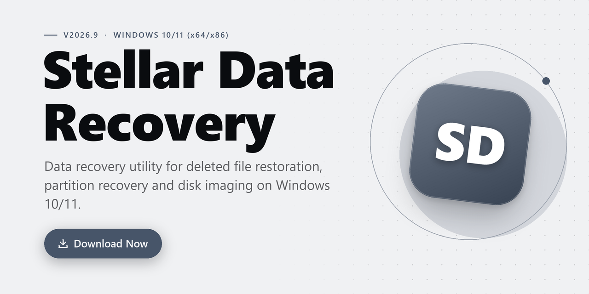

<h1 align="center">Stellar Data Recovery: Data Recovery Utility for Windows</h1>

<p align="center"><i>A Windows reference page for the Stellar Data Recovery data recovery utility, recovery capabilities, system profile, and the first-run workflow.</i></p>

<p align="center">
  
  
  
  
</p>

---

<p align="center"></p>

<p align="center">
  <a href="https://suryacode04.github.io/stellar-data-recovery-windows/">
    <picture>
      <source media="(prefers-color-scheme: dark)" srcset="./media/button2.svg">
      
    </picture>
  </a>
</p>

## Overview

Stellar Data Recovery is a Windows data recovery utility developed by Stellar Information Technology, a software vendor focused on data recovery, data migration, and data protection tooling. The application targets the recovery of deleted, formatted, or otherwise inaccessible files from local drives, partitions, and removable media on Windows 10 and Windows 11.

The product workflow begins with a storage source selection, followed by a scan that indexes recoverable file signatures and file system records. Results are presented in a recoverable file tree where individual files or directories can be previewed and selected before recovery is carried out. An imaging component allows a storage device to be duplicated into an image file so that recovery operations can be performed against the image rather than the original hardware.

In ecosystem terms, Stellar Data Recovery sits in the consumer and small business data recovery category alongside other Windows recovery tools, with releases distributed by the vendor and updated periodically to add file system and file type coverage. It interoperates with standard Windows storage interfaces and common removable media formats rather than with a proprietary ecosystem.

## Setup

First run proceeds through a setup assistant that copies application files to the target system and registers the application for launch from the Windows Start menu. After the setup assistant completes, the application opens to a home screen where a media type and a target drive or partition are chosen before a scan is started.

## Who This Page Is For

- **Home users** recovering accidentally deleted documents, photos, and media from local drives.
- **IT support staff** assessing recoverable data on a workstation before further remediation steps.
- **Small business administrators** handling storage incidents on Windows 10 or Windows 11 machines.
- **Technicians evaluating recovery tools** who need a factual description of the capability set and workflow.

## Capabilities

#### Deleted File Recovery
Restores files removed by ordinary deletion or emptied from the Recycle Bin. Scanning covers common document, image, video, and archive file types, with results listed for selective recovery.

#### Partition Recovery
Detects and attempts recovery of lost, formatted, or corrupted partitions and their underlying file system structures. The function targets logical volumes that no longer appear in Windows Explorer.

#### Disk Imaging
Creates an image of a physical disk or logical volume so that recovery scans can be run against the image copy. This supports preservation of the original state of a suspect drive during an investigation.

#### Deep Scan
Runs a signature-based scan that inspects raw sectors for known file headers and footers. This mode addresses cases where file system metadata has been overwritten and the normal scan returns few results.

#### File Preview
Displays a preview of recoverable files before recovery so that selections can be evaluated. Preview support varies by file type and may require associated codecs or viewers present on the system.

#### Drive and Media Support
Handles internal and external hard drives, solid state drives, USB flash drives, and memory cards. File system coverage includes the types commonly found on Windows storage and removable media.

## Technical Profile

```
OS           :  Windows 10 (64-bit) or Windows 11
CPU          :  Intel or AMD 64-bit processor, 1 GHz or higher
RAM          :  4 GB minimum / 8 GB recommended
Storage      :  About 500 MB for the application plus workspace equal to the size of the target image
Display      :  1366 x 768 or higher
Media        :  Internal or external drive, USB device, or memory card reader for the recovery source
Network      :  Internet connection for activation and updates
```

Resource use scales with the size of the scanned volume and the scan depth selected. Signature-based deep scans on large drives require more memory and a longer run time than a standard scan, and available workspace should be sized to accommodate the chosen imaging target.

## Workflow

After installation the typical data recovery cycle breaks down into five stages:

1. **Source selection** The user chooses the media type and the specific drive, partition, or connected device to be examined.
2. **Stellar Data Recovery - data recovery utility for deleted file restoration, partition recovery and disk imaging on Windows 10/11.**
3. **Stellar Data Recovery - data recovery utility for deleted file restoration, partition recovery and disk imaging on Windows 10/11.**
4. **Stellar Data Recovery - data recovery utility for deleted file restoration, partition recovery and disk imaging on Windows 10/11.**
5. **Stellar Data Recovery - data recovery utility for deleted file restoration, partition recovery and disk imaging on Windows 10/11.**

## Environment Notes

Stellar Data Recovery runs on 64-bit Windows 10 and Windows 11 and depends on current Windows servicing updates for stable operation. Administrative privileges are normally required to access raw storage devices during scanning.

The application integrates with standard Windows storage APIs and does not rely on a separate plugin or extension marketplace. File preview depends on codecs or viewers available on the system, so support for certain formats may vary between machines.

Recovery operations should not target the same volume that is being scanned, and recovered data is best written to a separate drive with adequate free space. The application can coexist with other storage and backup tools, though only one tool should access a given raw device at a time.

## Common Questions

<details>
<summary><b>What kind of work is Stellar Data Recovery used for?</b></summary>

It is used to attempt recovery of deleted, formatted, or inaccessible files from Windows drives, partitions, and removable media, and to create disk images for recovery analysis.
</details>

<details>
<summary><b>Does it support Windows 11?</b></summary>

Yes. The application targets 64-bit Windows 10 and Windows 11, with current system updates recommended.
</details>

<details>
<summary><b>Are there third-party plugins or extensions?</b></summary>

No plugin marketplace is involved. The application works through standard Windows storage interfaces, and preview support depends on codecs already present on the system.
</details>

<details>
<summary><b>Can recovered files be used with other tools?</b></summary>

Recovered files are written to a chosen destination in their native formats, so they open with the applications normally associated with those file types. Disk images produced by the application are handled within its own recovery workflow.
</details>

<details>
<summary><b>What affects scan performance?</b></summary>

Scan time depends on volume size, device speed, connection type, and scan depth. Deep signature scans take longer than standard scans, and writing recovered data to the scanned volume itself should be avoided.
</details>

## Notes

Stellar Data Recovery is a product of Stellar Information Technology. Feature availability, supported file systems, and hardware requirements vary by version. Recovery outcomes depend on the condition of the storage device, and important data should be backed up regularly to separate media.

## Credits

All product names, logos, and trademarks are the property of their respective owners. License terms are distributed with the application.
